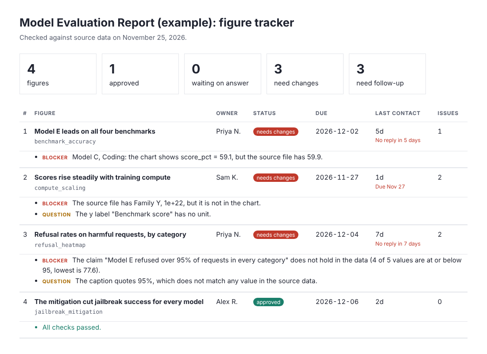

# figure-review-tracker

Check every figure in a report against its source data, track where each figure stands, and draft clear feedback to the researcher who owns it.

Built for the review step of a long report: many figures, many owners, deadlines, and a need to be sure every number on the page matches the data.



## What it checks

For each submitted figure (the plotted values + title, labels and caption, as JSON) and its source data file (CSV):

| Check | Severity | Example |
|---|---|---|
| Every plotted value equals the source value at the stated precision | blocker | `Model C, Coding: the chart shows 59.1, but the source file has 59.9.` |
| No source rows missing from the chart, no extra points | blocker | `The source file has Family Y, 1e+22, but it is not in the chart.` |
| Written claims hold in the data (max/min per group, all above a threshold, all lower after vs. before) | blocker | `"Model E refused over 95% ... in every category" does not hold (lowest is 77.6).` |
| Every percentage in the caption appears in the data (or is on an allow list, e.g. "95% CI") | question | `The caption quotes 95%, which does not match any value in the source data.` |
| Title present, axis labels present and include units | blocker / question | `The y label "Benchmark score" has no unit.` |
| Caption starts with "Figure N." | note | |

## What it produces

```
out/
  tracker.html      status board: owner, status, due date, days since last contact, open issues
  tracker.csv       same data for a spreadsheet
  followups.md      who to chase today (no reply in N days, or due within 2 days)
  feedback/*.md     a ready-to-send note per figure, with numbered questions
```

A drafted note looks like this:

```
Subject: Figure 2 review: 2 items before sign-off (Scores rise steadily with training compute)

Hi Sam,

I checked "Scores rise steadily with training compute" against data/scaling.csv.
1 item needs a change before it can go in the report. Could you help with these?

1. Should Family Y, 1e+22 be in the chart? If it was left out on purpose, can we say why in the caption?
   What I found: The source file has Family Y, 1e+22, but it is not in the chart.

2. What unit is "Benchmark score" in (for example %, points, or count)?
   What I found: The y label "Benchmark score" has no unit.

Could you reply by Thursday, Nov 26? Once these are settled I'll update the figure and mark it approved.
```

Each finding has a plain statement of what was found and a specific question, so the owner knows exactly what to answer.

## Quick start

```bash
pip install -r requirements.txt
python -m figreview manifest.yaml --today 2026-11-25
pytest -q
```

```
Figure 1 benchmark_accuracy     needs_changes      1 issue  -> follow up: No reply in 5 days
Figure 2 compute_scaling        needs_changes      2 issues  -> follow up: Due Nov 27
Figure 3 refusal_heatmap        needs_changes      2 issues  -> follow up: No reply in 7 days
Figure 4 jailbreak_mitigation   approved           0 issues
```

## The demo

[`scripts/make_submissions.py`](scripts/make_submissions.py) builds four submitted figures from the source data and plants realistic mistakes in three of them:

| Figure | Planted mistake | Caught as |
|---|---|---|
| benchmark_accuracy | One value typed as 59.1 instead of 59.9 | value_mismatch |
| compute_scaling | One data point left out; y-axis label has no unit | missing_row, units |
| refusal_heatmap | Caption claims something the data does not support | claim, caption_number |
| jailbreak_mitigation | None | approved |

## Adding a figure to the tracker

```yaml
- id: my_figure
  owner: Researcher name
  status: in_review
  due: 2026-12-10
  last_contact: 2026-11-25
  source: data/my_results.csv
  submitted: submissions/my_figure.json     # plotted values + title, labels, caption
  keys: [model, benchmark]                  # columns that identify a row
  values: [score_pct]                       # columns to compare
  decimals: 1                               # precision shown in the figure
  caption_allow: [95]                       # numbers in the caption that are methods, not data
  claims:
    - {type: max, column: score_pct, group_by: benchmark, entity_col: model, entity: Model E,
       text: "Model E scores highest on every suite"}
```

Submitted figure JSON matches what my eval-figure-kit project exports in `output/figure_data/`, so the two tools work together: build with the kit, review with this.

## About the data

All data is **synthetic** and the owner names are placeholders. "Model A" through "Model E" are not real AI models.

## License

MIT
